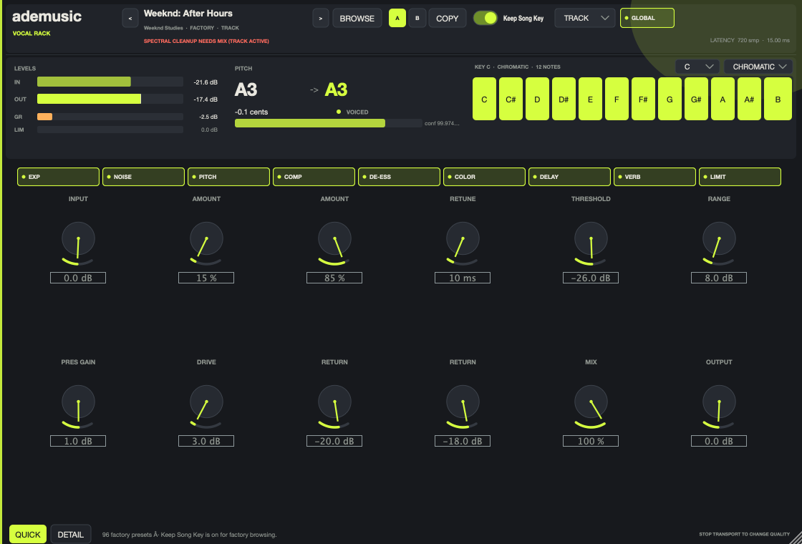

# ademusic Vocal Rack

A native mono/stereo vocal-chain plugin for Apple Silicon macOS, built in C++20
with JUCE 8 and CMake. It ships as one **VST3** and one **Audio Unit v2** from the
same processor, with real DSP, 96 editable factory presets, a resizable editor,
and versioned full-state recall.



> Artist names in preset descriptions describe production direction only. They
> do not imply affiliation, endorsement, or an exact recreation of any artist's
> record. All parameters are original designs.

## Download the latest release

**[ademusic Vocal Rack 1.2.0 (VST3 + AU) - 96 presets](https://github.com/ajdohaxhia/adevocalchain/releases/tag/v1.2.0)**

| Asset | Contents |
|---|---|
| [Combined ZIP](https://github.com/ajdohaxhia/adevocalchain/releases/download/v1.2.0/ademusic-vocal-rack-1.2.0-macOS-arm64.zip) | VST3 + AU + presets + install docs + verification logs |
| [VST3 ZIP](https://github.com/ajdohaxhia/adevocalchain/releases/download/v1.2.0/ademusic-vocal-rack-1.2.0-VST3-macOS-arm64.zip) | `ademusic Vocal Rack.vst3` |
| [AU ZIP](https://github.com/ajdohaxhia/adevocalchain/releases/download/v1.2.0/ademusic-vocal-rack-1.2.0-AU-macOS-arm64.zip) | `ademusic Vocal Rack.component` |
| [Factory presets](https://github.com/ajdohaxhia/adevocalchain/releases/download/v1.2.0/ademusic-vocal-rack-1.2.0-factory-presets.json) | Versioned JSON preset bank |
| [SHA-256 sums](https://github.com/ajdohaxhia/adevocalchain/releases/download/v1.2.0/SHA256SUMS.txt) | Asset checksums |

macOS arm64. The bundles are ad-hoc signed, not notarized; see
[INSTALL.txt](INSTALL.txt) for the user-level plug-in paths and the quarantine
command.

## What is in the chain

```
Input trim → Downward expander → Spectral denoiser → Pitch correction
           → Cleanup EQ (HPF + 2 cuts) → Compressor → De-esser
           → Tone EQ (low shelf, presence bell, high shelf) → Saturation
           → Dry vocal + parallel delay return + parallel reverb return
           → Global dry/processed mix → Output trim → Lookahead limiter
           → Output meter
```

- **Noise cleanup**: gentle stereo-linked expander (threshold, range, attack,
  hold, release, soft transition) plus a bounded STFT spectral reducer (amount,
  maximum reduction) for steady fan/hiss/room noise.
- **Tuning**: decimated YIN detector (80 Hz low rap tested at 8.5 cents error on
  Track), absolute-MIDI target selection across octaves, chromatic/major/minor/
  custom mask, A4 calibration, retune time, amount, humanize, Natural and Hard
  Tune starting points, phase-vocoder shifter with stereo-linked correction.
- **Dynamics and color**: soft-knee compressor with detector HPF and GR meter;
  split-band de-esser with detector audition; two saturation curves with 2x
  oversampling in Mix; sample-peak lookahead limiter with a guaranteed ceiling.
- **Space**: tempo-synced stereo/ping-pong delay (straight/dotted/triplet,
  feedback, filters, ducking) and an algorithmic Room/Plate FDN reverb
  (pre-delay, decay, damping, filters, return, ducking).

## Formats and identities

| | |
|---|---|
| Bundle ID | `com.ademusic.vocalrack` |
| AU | `aufx` / `Vrck` / `Adms` |
| VST3 CID | `ABCDEF019182FAEB41646D735672636B` |
| Architecture | arm64 (MacBook Air M4 target) |
| Latency | Track **720 samples / 15.00 ms** @48 kHz; Mix **3716 / 77.42 ms** |
| CPU | Track ~2.2 %, Mix ~2.6 % of block budget average (warmed Release, M4) |
| Validation | 400 headless checks, pluginval strictness 7 (VST3 + AU), auval PASS |

## Build

Requirements: macOS 12+, Apple Silicon, CMake 3.22+, Xcode Command Line Tools.
JUCE is pinned to **8.0.15** (commit
`91ad83ae34a81e0833b1a2b0866f54846370ae53`). The build needs no network after
the first configure unless CMake has to fetch JUCE.

```bash
./scripts/build.sh
# or, with an offline JUCE checkout:
VR_JUCE_PATH=/path/to/JUCE-8.0.15 ./scripts/build.sh
```

Outputs:

```
build-release/VocalRack_artefacts/Release/VST3/ademusic Vocal Rack.vst3
build-release/VocalRack_artefacts/Release/AU/ademusic Vocal Rack.component
build-release/VocalRackTests_artefacts/Release/VocalRackTests
```

The CMake presets mirror this:

```bash
VR_JUCE_PATH=/path/to/JUCE-8.0.15 cmake --preset release-arm64
cmake --build --preset release-arm64
```

## Test and validate

```bash
./scripts/test.sh          # DSP/session suite, latency table, CPU benchmark
./scripts/validate.sh      # signs, installs AU, pluginval, auval, host harness
./scripts/package.sh       # produces the local ZIP and verifies extraction
```

See `docs/VERIFICATION.md` for measured results and
`docs/MANUAL_CHECKLIST.md` for the exact Logic/VST3-host and listening steps that
remain environment-blocked here.

## Install

```bash
mkdir -p ~/Library/Audio/Plug-Ins/VST3 ~/Library/Audio/Plug-Ins/Components
cp -R "dist/ademusic-vocal-rack-1.2.0-macOS-arm64/VST3/ademusic Vocal Rack.vst3" \
      ~/Library/Audio/Plug-Ins/VST3/
cp -R "dist/ademusic-vocal-rack-1.2.0-macOS-arm64/Components/ademusic Vocal Rack.component" \
      ~/Library/Audio/Plug-Ins/Components/
```

Full instructions, quarantine removal, and the exact Logic/REAPER checklist are
in `INSTALL.txt` and `docs/MANUAL_CHECKLIST.md`.

## Presets

- 96 factory presets in sixteen banks: Tracking and Cleanup, Rap and Trap, Pop and
  Dance, R&B and Melodic, Natural and Acoustic, Effects and Throws,
  Artist-Inspired Leads, Modern Rap Chains, Pop, Soul & Rock,
  Broadcast & Live, Weeknd Studies, Dua Lipa Studies, Drake Studies,
  Kanye Studies, Modern Pop Studies, and R&B & Hip-Hop Studies. Artist references are descriptive production directions
  only; no affiliation or endorsement is implied.
- Embedded in the plugin and mirrored in
  `presets/ademusic-vocal-rack-factory.json`.
- Fully editable parameter states; factory entries immutable.
- User presets are versioned JSON, atomically written under
  `~/Library/Application Support/ademusic/Vocal Rack/Presets/`.
- Browser supports bank filter, search, descriptions, use case, first-move
  guidance, Save As, duplicate, rename, delete, import and export.
- **Keep Song Key** defaults on for factory browsing and preserves tonic, scale
  and mask. Full session recall always restores the saved tuning.
- A/B stores complete states including output trim for level matching.

See `docs/PRESET_FORMAT.md` for the schema.

## Quality configurations

- **Track**: low-latency expander + tuning; spectral cleanup unavailable.
- **Mix**: adds the full spectral denoiser and 2x saturation oversampling.
- Presets never change this configuration. Changing it re-prepares the engine and
  updates host latency; the UI states that transport should be stopped if the host
  does not re-align live. Edits are preserved.

## Source layout

```
Source/Parameters.*        stable 82-parameter schema and cache
Source/Engine.*            chain, latency budget, dry alignment, metering
Source/dsp/                detector, selector, shifter, denoiser, reverb, modules
Source/Presets.*           factory/user JSON library and validation
Source/PluginProcessor.*   APVTS, host state, A/B, quality, preset identity
Source/PluginEditor.*      resizable Quick/Detail editor and preset browser
Tests/Tests.cpp            headless DSP, preset, state and host harness
Tools/generate_presets.py  factory bank generator
scripts/                   build/test/validate/install/package
```

## Known limitations

- Built and validated **arm64 only**; no universal binary was produced.
- The local bundles are **ad-hoc signed**, not Developer ID signed or notarized.
- Real DAW and human listening passes were not possible on this machine; the
  exact manual checklist is supplied.
- The limiter enforces **sample peak**, not True Peak. No True Peak mode is
  claimed or labelled.
- Spectral cleanup is Mix-only by design. In Track, the UI flags presets that
  request it.
- On max-decay settings the reverb is a long tail; render length/PDC is the
  host's responsibility. Tail is reported as 10 s.
- No formant control is exposed: no formant-preserving shifter was implemented,
  so no unverifiable control is shown.

## Licence

Original source: AGPL-3.0-or-later. JUCE 8.0.15 is dual AGPLv3/commercial; this
build uses the AGPLv3 path. Closed-source distribution requires a JUCE
commercial licence. The adapted phase vocoder keeps its MIT notice. See
`LICENSE`, `LICENSES/`, and `THIRD_PARTY_NOTICES.md`.
